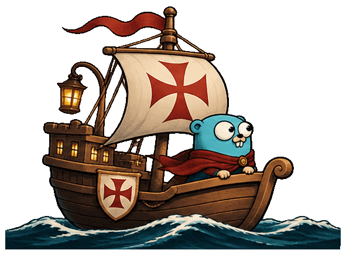

<div align="center">


<br /><br />

<picture>
  <source media="(prefers-color-scheme: dark)" srcset="./assets/stream-hud-dark.svg" />
  <source media="(prefers-color-scheme: light)" srcset="./assets/stream-hud-light.svg" />
  
</picture>

<br />

<sub><i>"the country? the skies? you can have them."</i></sub>

</div>

<p align="center">
  <picture>
    <source media="(prefers-color-scheme: dark)" srcset="./assets/timeline-divider-dark.svg" />
    <source media="(prefers-color-scheme: light)" srcset="./assets/timeline-divider-light.svg" />
    
  </picture>
</p>

### `// engineering focus`

**Builder** and CS undergrad at **UFF**, focused on **video streaming** and distributed backend systems.

- **Video Streaming** · Delivery, packaging, and playback workflows across `HLS`, `DASH`, `MSS`, `DRM`, and `FFmpeg`
- **Backend & Distributed Systems** · Services in **Go**, message queues (`RabbitMQ`), `WebSockets`, and systems design
- **Cloud & Observability** · Container orchestration (`Kubernetes`, `Tsuru`), cloud infrastructure, and telemetry (`Prometheus`, `Grafana`)
- **Developer Tooling** · Local-first markdown systems and agent workflows

### `// projects`

| Project | Overview | Stack |
| :--- | :--- | :--- |
| [**`automationReels`**](https://github.com/guipimentel30/automationReels) | Automated media processing pipeline for speech transcription and frame-accurate subtitle burn-in | `Python` `Whisper` `FFmpeg` |
| [**`SimulatedScheduler`**](https://github.com/guipimentel30/SimulatedScheduler) | Operating system kernel simulator implementing preemptive Round-Robin CPU scheduling and paged memory allocation | `Python` `OS` |
| [**`Haskell`**](https://github.com/guipimentel30/Haskell) | Algorithmic search and formal verification exploring the Knight's Tour problem | `Haskell` `Lean` |
| [**`Create-Hack`**](https://github.com/guipimentel30/Create-Hack) | End-to-end web application prototyped and shipped under hackathon constraints | `TypeScript` |

### `// tech stack`

```yaml
languages     : go · python · c
streaming     : hls · dash · mss · drm · ffmpeg
infra & cloud : kubernetes · tsuru · cloud · rabbitmq
observability : prometheus · grafana
exploring     : java · spring boot · react · webgpu · haskell · lean
```

### `// off-screen`

`reading` · philosophy & christianity  
`tinkering` · building and breaking things  
`sports` · lifting, football & tennis

<br />

<div align="center">
  

  <br />

  <sub><i>navigare necesse est.</i></sub>
</div>

<br />

<p align="center">
  <sub><code>EOF · 00:00:24 · guipimentel30</code></sub>
</p>